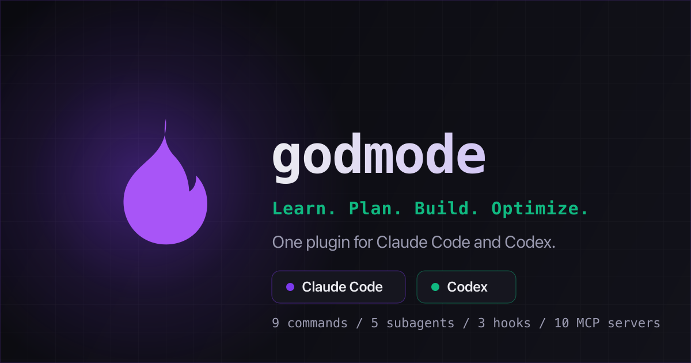

# Godmode

**Learn. Plan. Build. Optimize.** One plugin that gives Claude Code and Codex the same nine coding workflows and ten documentation and tooling MCP servers, built from a single source.

[](https://github.com/patrickking67/godmode/actions/workflows/ci.yml)
[](LICENSE)

Site: **https://patrickking67.github.io/godmode/**

[](https://patrickking67.github.io/godmode/)

Most agent setups grow one plugin at a time: a review prompt here, a docs server there, a different copy for each engine. Godmode packages that surface once. You author a workflow as a Markdown file, run one build, and get a plugin that installs from a marketplace in either engine with no per-repo setup, no server and no API keys.

## What you get

| Surface         | Count | Engines            | Where it lives                      |
| --------------- | ----- | ------------------ | ----------------------------------- |
| Workflow skills | 9     | Claude Code, Codex | `plugin/skills/<name>/SKILL.md`     |
| Subagents       | 5     | Claude Code        | `plugin/agents/<name>.md`           |
| Hooks           | 3     | Claude Code        | `plugin/hooks/hooks.json` + scripts |
| MCP servers     | 10    | Claude Code, Codex | `plugin/.mcp.json`                  |

### Workflow skills

| Skill        | Pillar | What it does                                                               |
| ------------ | ------ | -------------------------------------------------------------------------- |
| `revelation` | Learn  | Explores a codebase and explains how it fits together.                     |
| `gospel`     | Learn  | Explains how a file, symbol, function, flow or error works.                |
| `prophecy`   | Plan   | Step-by-step guidance for a task, grounded in this repo.                   |
| `genesis`    | Build  | Implements a change with a tight plan, build and verify loop.              |
| `summon`     | Build  | Picks the right subagent for a task and dispatches it.                     |
| `judgment`   | Review | Reviews uncommitted (or named) changes for bugs, security and drift.       |
| `sanctify`   | Review | Runs the project's own checks (typecheck, tests, lint, build) and reports. |
| `exorcise`   | Debug  | Finds the root cause of a bug or failing test before fixing it.            |
| `covenant`   | Ship   | Turns the current changes into one Conventional Commit.                    |

### Subagents and hooks (Claude Code)

- **Subagents:** `oracle` (read-only reconnaissance), `demiurge` (implements a scoped change), `inquisitor` (code review), `arbiter` (runs the checks), `seer` (root-cause analysis). `summon` routes work to them.
- **SessionStart** adds a short summary of the workflows and subagents to the session context.
- **PreToolUse on Bash** asks for confirmation before destructive commands such as `rm -rf`, `git push --force`, `git reset --hard` or piping a download into a shell. It asks; it never blocks.
- **PostToolUse on Edit/Write** runs `prettier --write` on the edited file, only when the project already has a prettier config and prettier installed. Everywhere else it does nothing.

Codex ignores the subagents. It can load plugin hooks, but only after you review and trust them.

### MCP servers

None of them need an API key. Six are remote HTTPS endpoints; four run locally through `npx`.

| Server            | Type          | Category          | Gives you                                                    |
| ----------------- | ------------- | ----------------- | ------------------------------------------------------------ |
| `context7`        | stdio (`npx`) | Docs              | Current, version-aware docs for libraries and frameworks     |
| `microsoft-learn` | HTTPS         | Docs              | Microsoft and Azure documentation and code samples           |
| `aws-knowledge`   | HTTPS         | Docs              | AWS documentation, code samples and regional availability    |
| `cloudflare-docs` | HTTPS         | Docs              | Cloudflare developer platform documentation                  |
| `keeper-docs`     | HTTPS         | Docs              | Keeper Security documentation                                |
| `deepwiki`        | HTTPS         | Code intelligence | Questions about any public GitHub repo's architecture        |
| `grep`            | HTTPS         | Code intelligence | Regex code search across public GitHub repositories          |
| `playwright`      | stdio (`npx`) | Browser           | Drives a real browser for testing and screenshots            |
| `chrome-devtools` | stdio (`npx`) | Browser           | DOM, network, console and performance traces in Chrome       |
| `azure`           | stdio (`npx`) | Cloud             | Azure resources and deployments, using your local `az login` |

The `npx` servers need Node 22 or later and download their package on first use.

## Install

### Claude Code

```text
/plugin marketplace add patrickking67/godmode
/plugin install godmode@godmode
```

Or from your shell:

```sh
claude plugin marketplace add patrickking67/godmode
claude plugin install godmode@godmode
```

The skills, subagents, hooks and MCP servers load from the plugin. Run `claude plugin details godmode` to see the inventory.

### Codex

```sh
codex plugin marketplace add patrickking67/godmode
codex plugin add godmode@godmode
```

The nine skills install with the plugin, and the plugin points Codex at the same `.mcp.json`, so `codex mcp list` shows the ten servers afterward. To add the servers without the plugin, run `bash plugin/codex-mcp-setup.sh` from a clone, or append `plugin/codex-config.toml` to `~/.codex/config.toml`.

### From a local clone

```sh
git clone https://github.com/patrickking67/godmode.git
claude plugin marketplace add /absolute/path/to/godmode   # or: codex plugin marketplace add ...
```

Then install `godmode@godmode` as above.

## Example workflow

Claude Code namespaces plugin skills, so each workflow runs as `/godmode:<name>`. In Codex the same skills are listed as `godmode:<name>`; name one in your prompt to use it.

```text
/godmode:revelation map the auth flow in this service
/godmode:prophecy add rate limiting to the login endpoint
/godmode:genesis add rate limiting to the login endpoint, following that plan
/godmode:judgment
/godmode:sanctify
/godmode:covenant
```

That is learn, plan, build, review, verify and commit, each step with its own instructions, and the same steps in either engine. When a test starts failing along the way, `/godmode:exorcise` traces it to the cause before anything gets patched.

## How it works

```text
src/plugin/_sources/            one source of truth
  commands/<name>.md            workflow: frontmatter + Markdown body
  agents/<name>.md              Claude Code subagents
  hooks/                        hooks.json + Node scripts
  mcps.ts                       the ten MCP server definitions
  manifest.ts                   plugin identity and the Codex interface block
        |
        |  pnpm build:plugin  (scripts/build-plugin.ts)
        v
plugin/                         generated, committed, installable
  .claude-plugin/plugin.json    Claude Code manifest
  .codex-plugin/plugin.json     Codex manifest
  skills/<name>/SKILL.md        one copy of each workflow, loaded by both engines
  agents/  hooks/  .mcp.json
  codex-config.toml             manual Codex fallback
  codex-mcp-setup.sh            manual Codex fallback
.claude-plugin/marketplace.json marketplace catalog read by both engines
```

A few decisions worth knowing about:

- **One skill per workflow.** Both engines load `skills/`, and both also read a plugin's `commands/` folder (Codex converts those files into skills). Emitting a workflow to both folders would register it twice, so the build writes `skills/` only.
- **Schema checks at build time.** The emitter validates both manifests with ajv and fails on a bad name, an npm-style `repository` object, a missing MCP pointer or an incomplete Codex `interface` block. It also rejects a source name that is not kebab-case or that two sources share, before it writes anything.
- **Generated output is committed and checked.** CI rebuilds the plugin and fails if `plugin/` differs from what the sources produce. A test does the same comparison locally.
- **No secrets anywhere.** Every bundled server is public or uses ambient credentials (`az login`).

Design notes live in [`docs/specs/`](docs/specs/) and [`docs/plans/`](docs/plans/). Agents working in the repo should start with [`AGENTS.md`](AGENTS.md); [`llms.txt`](llms.txt) indexes the docs for LLM tools.

## Development

Requires Node 22+ and pnpm.

```sh
pnpm install --frozen-lockfile
pnpm check             # build:plugin, typecheck, lint, fmt:check, test
```

`pnpm check` is what CI runs, followed by a `git diff` that fails if the build changed any committed file. The single steps are `pnpm build:plugin`, `pnpm typecheck`, `pnpm lint`, `pnpm fmt:check` and `pnpm test`.

To check the packaging against the installed Claude Code:

```sh
pnpm validate:plugin   # claude plugin validate --strict on the catalog and ./plugin
```

### Tests

The vitest suite covers the frontmatter parser, the three MCP emitters, manifest schema validation, source name checks, a byte-for-byte drift check of `plugin/` against a fresh build, skill frontmatter, hook wiring, version sync across manifests, the behavior of all three hook scripts, and the site: data parity with the plugin, the no-JavaScript fallback and `llms.txt`.

### Site and deploy

The landing page in `site/` is static HTML, CSS and one script with no build step. Preview it with:

```sh
python3 -m http.server 4103 --directory site   # http://localhost:4103/
```

Pushing to `main` deploys `site/` to GitHub Pages through `.github/workflows/pages.yml`. The plugin itself has no deploy step: both engines install the committed `plugin/` from the repository.

To add a workflow, create `src/plugin/_sources/commands/<name>.md` with `name`, `description` and optional `allowed-tools` frontmatter, then run `pnpm build:plugin` and commit the regenerated `plugin/` with it. See [`CONTRIBUTING.md`](CONTRIBUTING.md).

## Roadmap

Shipped in 1.3.0: the nine workflows, five subagents, three hooks, ten MCP servers, both engines and the site. Designed but not built yet: persistent project and global memory, token and cost tracking, and a local dashboard. See [`docs/specs/2026-05-27-godmode-design.md`](docs/specs/2026-05-27-godmode-design.md).

## Security and license

Report vulnerabilities privately as described in [`SECURITY.md`](SECURITY.md). Licensed under the [Apache License, Version 2.0](LICENSE).
