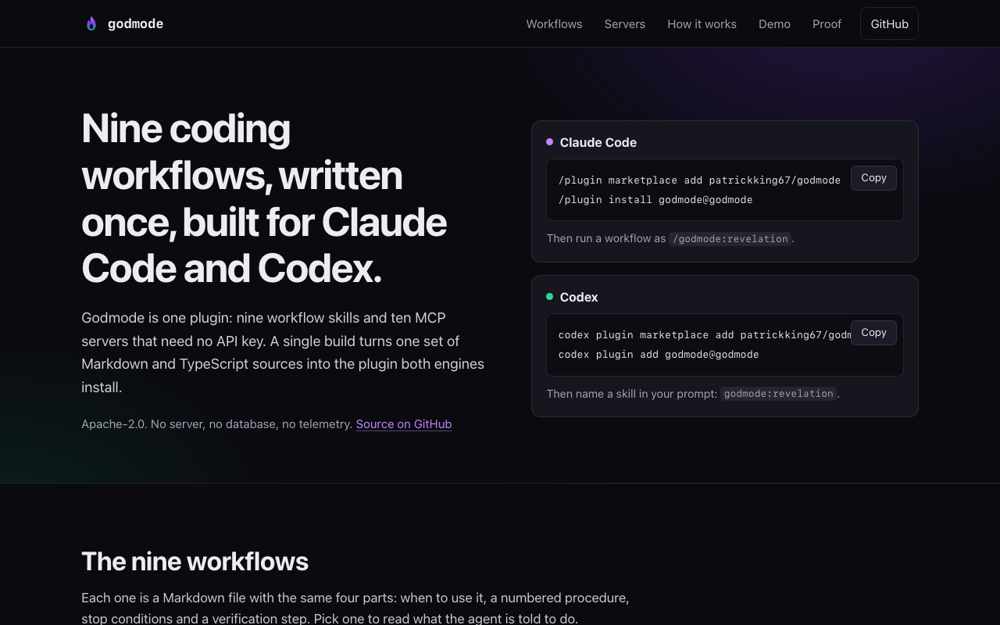
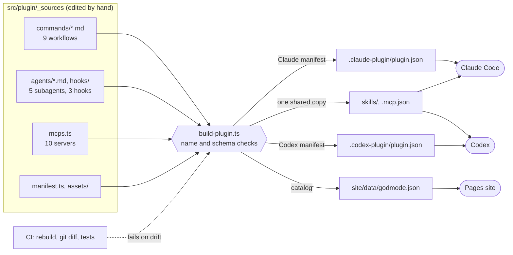

<p align="center">
  
</p>

# Godmode

One plugin for Claude Code and Codex: nine coding workflow skills and ten no-auth MCP servers, written once and emitted for both engines by a single build that CI checks byte for byte.

[](https://github.com/patrickking67/godmode/actions/workflows/ci.yml)
[](LICENSE)
[](tests/)
[](https://patrickking67.github.io/godmode/)

[](https://patrickking67.github.io/godmode/)

## Try it

Live site with the full catalog: **https://patrickking67.github.io/godmode/**

```sh
# Claude Code
claude plugin marketplace add patrickking67/godmode
claude plugin install godmode@godmode

# Codex
codex plugin marketplace add patrickking67/godmode
codex plugin add godmode@godmode
```

In Claude Code, run a workflow as `/godmode:revelation`. In Codex, name it in your prompt: `godmode:revelation`. Inside either app the same install is `/plugin marketplace add patrickking67/godmode` then `/plugin install godmode@godmode`.

## What is technically interesting here

- **One source, three outputs.** Workflows, subagents, hooks and servers are defined once in [`src/plugin/_sources/`](src/plugin/_sources/). [`scripts/build-plugin.ts`](scripts/build-plugin.ts) emits the Claude Code manifest, the Codex manifest, the shared skills and the site's catalog from them. Golden-output tests pin each emitter: [`tests/plugin/emitters.test.ts`](tests/plugin/emitters.test.ts).
- **Generated output is committed and proven current.** Both engines install `plugin/` straight from the repository, so it has to be in git. CI rebuilds and fails on any diff, and [`tests/plugin/packaging.test.ts`](tests/plugin/packaging.test.ts) does the same comparison locally, as bytes, including the icons.
- **Engine differences live in the emitter, not in the workflows.** A source marked `invocation: manual` becomes `disable-model-invocation: true` for Claude Code and an `agents/openai.yaml` policy file for Codex. The commit workflow uses it so neither engine commits on its own initiative.
- **Skills are linted like code.** [`tests/plugin/skills.test.ts`](tests/plugin/skills.test.ts) requires a trigger in every description, four fixed sections, numbered steps, and no reference to a workflow, subagent or server that does not ship. It also rejects a skill that pre-approves a bare shell or edit tool.
- **Names are treated as untrusted input.** A workflow name becomes a path, a TOML key and a shell word. The build rejects anything that is not kebab-case before writing a file, and shell-quotes arguments in the generated Codex script: see `validateSourceNames` and `shQuote`.
- **Claims are tested.** [`tests/catalog.test.ts`](tests/catalog.test.ts) fails if the README, the docs, the site or a manifest lists a different server or states a different count than the sources produce. [`scripts/check-claims.mjs`](scripts/check-claims.mjs) does the same for the test count in the badge above.

## Architecture



Both engines scan `skills/`, and both also read a plugin's `commands/` folder, so a workflow emitted to both would register twice. The build writes each workflow once. Deeper diagrams, including the build's validation order and the manual-invocation fan-out, are in [`docs/architecture.md`](docs/architecture.md).

## What ships

| Surface         | Count | Engines            | Generated at                        |
| --------------- | ----- | ------------------ | ----------------------------------- |
| Workflow skills | 9     | Claude Code, Codex | `plugin/skills/<name>/SKILL.md`     |
| MCP servers     | 10    | Claude Code, Codex | `plugin/.mcp.json`                  |
| Subagents       | 5     | Claude Code        | `plugin/agents/<name>.md`           |
| Hooks           | 3     | Claude Code        | `plugin/hooks/hooks.json` + scripts |

### Workflows

Each skill has the same shape: when to use it, a numbered procedure, stop conditions, and a verification step.

| Skill        | Group  | What it does                                                                |
| ------------ | ------ | --------------------------------------------------------------------------- |
| `revelation` | Learn  | Maps a codebase or subsystem and explains how it fits together.             |
| `gospel`     | Learn  | Explains one file, symbol, flow or error by tracing the real code path.     |
| `prophecy`   | Plan   | Writes a repo-specific plan for a task without changing files.              |
| `genesis`    | Build  | Implements a change in small tested steps and runs the project's checks.    |
| `summon`     | Build  | Lists the available subagents and picks one for a task.                     |
| `judgment`   | Review | Reviews a diff for bugs, security flaws and drift. Read-only.               |
| `sanctify`   | Review | Runs the project's own checks and reports pass or fail per check.           |
| `exorcise`   | Debug  | Finds the root cause of a failure before fixing it.                         |
| `covenant`   | Ship   | Creates one Conventional Commit. Manual only: it runs when you ask by name. |

In Claude Code the skills pre-approve read-only tools and a few named git commands. Edits and other shell commands still go through your permission settings.

### MCP servers

No server needs an API key or a token in config. Six are public HTTPS endpoints; four are npm packages started through `npx` (Node 22.12 or later).

| Server            | Type          | Category          | Gives you                                                    |
| ----------------- | ------------- | ----------------- | ------------------------------------------------------------ |
| `context7`        | stdio (`npx`) | Docs              | Current, version-aware docs for libraries and frameworks     |
| `microsoft-learn` | HTTPS         | Docs              | Microsoft and Azure documentation and code samples           |
| `aws-knowledge`   | HTTPS         | Docs              | AWS documentation, code samples and regional availability    |
| `cloudflare-docs` | HTTPS         | Docs              | Cloudflare developer platform documentation                  |
| `keeper-docs`     | HTTPS         | Docs              | Keeper Security documentation                                |
| `deepwiki`        | HTTPS         | Code intelligence | Questions about any public GitHub repo's architecture        |
| `grep`            | HTTPS         | Code intelligence | Regex code search across public GitHub repositories          |
| `playwright`      | stdio (`npx`) | Browser           | Drives a real browser for testing and screenshots            |
| `chrome-devtools` | stdio (`npx`) | Browser           | DOM, network, console and performance traces in Chrome       |
| `azure`           | stdio (`npx`) | Cloud             | Azure resources and deployments, using your local `az login` |

Endpoints, upstream repositories and the last live check are in [`docs/mcp-servers.md`](docs/mcp-servers.md).

### Subagents and hooks (Claude Code)

- **Subagents:** `oracle` (read-only reconnaissance), `demiurge` (implements a scoped change), `inquisitor` (review), `arbiter` (runs the checks), `seer` (root-cause analysis).
- **SessionStart** adds a short list of the workflows and subagents to the session context.
- **PreToolUse on Bash** asks before destructive commands such as `rm -rf` or `git push --force`. It asks; it never blocks.
- **PostToolUse on Edit and Write** runs `prettier --write` on the edited file, only where the project already uses prettier.

Codex ignores the subagents and loads plugin hooks only after you review and trust them.

## Quality signals

| Signal        | What is true today                                                                                     |
| ------------- | ------------------------------------------------------------------------------------------------------ |
| Tests         | 238 vitest tests in 9 files: emitters, packaging, hooks, skill lint, catalog parity, site              |
| Drift check   | CI rebuilds, then `git diff --exit-code`; a test compares `plugin/` to a fresh build byte for byte     |
| Static checks | TypeScript strict, ESLint, Prettier, all in `pnpm check`                                               |
| Engine checks | `claude plugin validate --strict` passes on the catalog and the plugin (`pnpm validate:plugin`)        |
| Server checks | `pnpm verify:mcps` started all ten servers with no credentials on 2026-11-12                           |
| Security      | No secrets in any definition (tested); skills cannot pre-approve a bare shell (tested)                 |
| Accessibility | Site checked at 1280 and 375 px: keyboard tab pattern, visible focus, reduced motion, works without JS |
| CI            | One job, Node 22, pnpm 9, read-only token                                                              |

Coverage is not measured.

## Develop

Requires Node 22 or later and pnpm.

```sh
pnpm install --frozen-lockfile
pnpm check             # build, typecheck, lint, format check, tests, published-count check
pnpm validate:plugin   # claude plugin validate --strict (needs the claude CLI)
pnpm verify:mcps       # live check of the ten servers (needs the network)
python3 -m http.server 4103 --directory site   # preview the site at http://localhost:4103/
```

```text
src/plugin/_sources/   the single source: commands/, agents/, hooks/, assets/, mcps.ts, manifest.ts, site.ts
scripts/               build-plugin.ts (emitter), verify-mcps.mjs, check-claims.mjs
plugin/                generated, committed, installable (do not hand-edit)
site/                  static landing page; data/godmode.json is generated
tests/                 vitest suites
docs/                  architecture.md, mcp-servers.md, design notes
```

To add a workflow, create `src/plugin/_sources/commands/<name>.md`, run `pnpm build:plugin` and commit the regenerated output with it. Pushing to `main` deploys `site/` to GitHub Pages; the plugin has no deploy step because both engines install the committed `plugin/`.

More: [`AGENTS.md`](AGENTS.md) for the full agent guide, [`CONTRIBUTING.md`](CONTRIBUTING.md), [`CHANGELOG.md`](CHANGELOG.md), [`SECURITY.md`](SECURITY.md), [Privacy](#privacy).

## Privacy

Godmode runs no server and collects nothing. The bundled MCP servers are third-party services: a request reaches one only when the agent calls its tools, and each operator's own terms and privacy policy apply. Links to every operator are in [`docs/mcp-servers.md`](docs/mcp-servers.md).

## Roadmap

Designed but not built: persistent memory, token and cost tracking, and a local dashboard. See [`docs/specs/2026-05-27-godmode-design.md`](docs/specs/2026-05-27-godmode-design.md).

## License

[Apache License 2.0](LICENSE).
