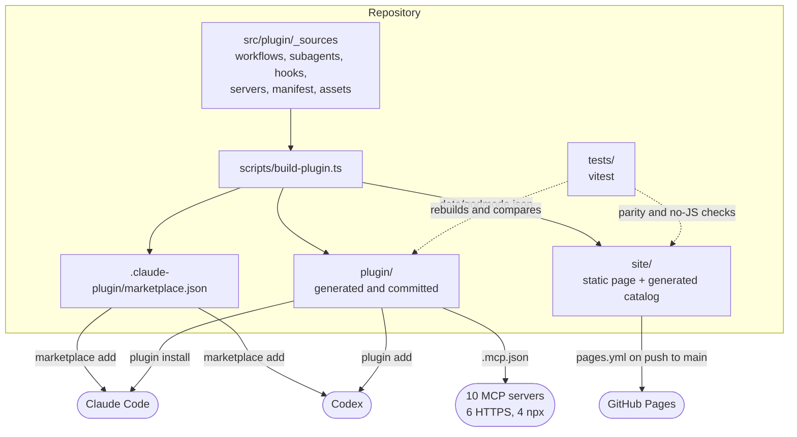
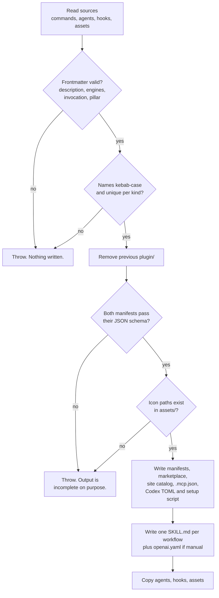
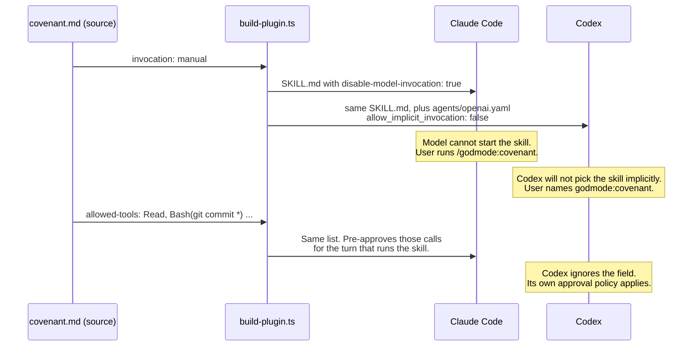

# Architecture

Godmode has no runtime of its own. It is a set of source files, a build script that turns
them into an installable plugin, and tests that keep the two in step. This page shows how
the pieces connect.

## Components

What to notice: both engines read the same `marketplace.json` and the same `plugin/`
folder. Codex accepts a Claude-style marketplace, so there is one catalog, not two. The
site is a consumer of the build like the engines are; its catalog is generated, which is
why it cannot list a workflow that does not ship.

## What the build does, in order

What to notice: name and frontmatter checks run before anything is deleted, so a bad
source leaves the committed plugin untouched. Names are checked because they become file
paths, TOML keys and shell words: a frontmatter `name: ../x` would otherwise write outside
`plugin/`. The build is deterministic and removes stale files, so running it twice
produces identical bytes, which is what lets CI use a plain `git diff` as the drift check.

## One source field, two engine-specific outputs

The most interesting mechanism is small. Claude Code and Codex agree on the skill file
format but disagree on how to say "do not run this unless the user asks". The workflow
source states the intent once and the emitter translates it.

What to notice: the workflow text itself stays engine-neutral. It never uses
`$ARGUMENTS` (Codex does not substitute it) or a tool name that exists in only one
engine; `tests/plugin/skills.test.ts` enforces that. `allowed-tools` is a grant, not a
restriction, so the same test only allows read-only tools and named git commands in it,
and only a manual workflow may pre-approve `git add` or `git commit`.

## The gates

| Gate                              | Where it runs                 | What it stops                                                 |
| --------------------------------- | ----------------------------- | ------------------------------------------------------------- |
| Name and frontmatter checks       | Build                         | Path escape, duplicate outputs, unknown engine or invocation  |
| Manifest JSON schema (ajv)        | Build                         | A manifest either engine would reject at install time         |
| Drift check                       | CI (`git diff`) and a test    | Hand-edited or stale generated files                          |
| Skill lint                        | `tests/plugin/skills.test.ts` | Missing triggers or sections, broken references, broad grants |
| Catalog parity                    | `tests/catalog.test.ts`       | Docs, site or manifest disagreeing with the sources           |
| Published-count check             | `scripts/check-claims.mjs`    | A stale test count in the README or on the site               |
| `claude plugin validate --strict` | `pnpm validate:plugin`        | Fields Claude Code does not accept                            |
| Live server check                 | `pnpm verify:mcps`            | A bundled server that is gone or now needs a key              |

The last two need the Claude CLI and the network, so they are run by hand and are not
part of CI.

## Codex packaging note

OpenAI's current plugin documentation describes a portable layout (a root `plugin.json`
with `extensions.com.openai`, and `mcp.json`) and keeps `.codex-plugin/plugin.json` as a
supported compatibility layout. Godmode emits the compatibility layout because the same
folder must also be a valid Claude Code plugin, which reads `.claude-plugin/plugin.json`
and `.mcp.json`. Checked against codex-cli 0.167.0 on 2026-11-12: the plugin installs into
a clean Codex home and `codex mcp list` shows all ten servers.
